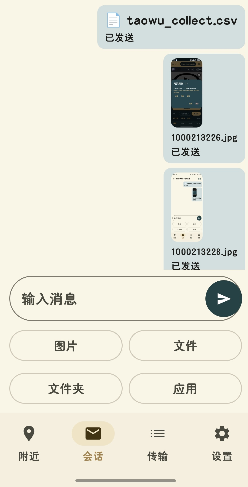

# 大司农

<p align="center">
   
</p>

使用方法：

1、若是电脑我只开发了适合Windows的版本，安卓手机当然我也开了，先下载

2、下载后Windows版本则只需找个地方解压即可，双击“大司农.exe”即可运行，若是安卓版本则只需下载进安卓手机，安装后，点击图标即可使用

3、连接方式分为：一台设备开热点，另一台设备连接，两台设备即可通信传文件发消息
                也可以局域网下连接之后传输

4、若是安卓，端匹配到设备后，点击设备卡片里的连接按钮连接，然后再按下配对按钮，请仔细核对六位数号码，不对不能连

5、若是Windows则是点击底下那一栏的连接设备和配对按钮即可，参照安卓的操作是一样的

6、Windows端可以直接把文件拖进会话框直接就能传输

7、在设置页面你可以指定接收文件夹的位置和数据文件夹的位置，请按下右边的选择即可

8、设置页面可以设置TCP并发数，按需自己调

9、安卓端和Windows端的附近页面里都有保持连接的滑块，开了就是不限时间的保持连接

10、请勿连接陌生设备

介绍

局域网（含手机热点）下自动发现设备，**互传文件 / 图片 / 文件夹** 并 **聊天式互发信息**。
无服务器、不走互联网。任意组合互通：Android↔Windows、Android↔Android、Windows↔Windows。

> 定位：从零自己实现的一套 **LocalSend 同类工具**（不是 LocalSend 的 fork，也不是「局域网版微信」）。
> 相比 LocalSend 强化：聊天式互发信息、重做界面、更稳的发现/连接、**并行分块 + 断点续传**。
> **核心场景**：一台设备不联网、只开热点，另一台连上该热点，两者即可互相发现并通信。

## 目录结构

```
大司农/
├── protocol/PROTOCOL.md      # 双端唯一事实源（协议 v3）
├── 大司农-android/
│   ├── UI/                   # :ui       Compose 前端（com.dasinong.ui）
│   └── 后端/                  # :backend  Kotlin 网络/协议/传输（com.dasinong.backend）
└── 大司农-win/
    ├── 后端/dasinong_core/    # Python 网络/协议/传输（纯 stdlib + psutil）
    ├── UI/dasinong_ui/        # PySide6 前端
    ├── run.py                 # 入口
    └── smoke_test.py          # 单机双实例端到端自测
```

## Windows 端

```bash
cd 大司农-win
pip install -r requirements.txt

python run.py                 # 启动 GUI（最小化后驻留托盘）
python smoke_test.py          # 端到端自测：发现/文本/文件/文件夹/断点续传
python -m pytest tests -q     # 单元测试
```

单机跑两个实例（联调）：

```bash
python run.py
DASINONG_TCP_PORT=37022 DASINONG_DATA_DIR=./_data_b DASINONG_DEVICE_NAME=Win-B python run.py
```

可用环境变量：`DASINONG_UDP_PORT` / `DASINONG_TCP_PORT` / `DASINONG_DATA_DIR` / `DASINONG_DEVICE_NAME`。

**防火墙（最常见的问题）**：热点网络通常被 Windows 判为「公用」profile，默认**拦截入站**，表现为**能发现设备但发不出消息/文件**，且常是**单向**的（对方能发给你、你发不回去）。放行方式任选：

```
# 方式一（推荐）：程序启动后会自动检测，缺失就弹窗 —— 点「立即放行」即可（会弹一次管理员授权）
#          选「不再提示」会记住，之后不再打扰
```

```powershell
# 方式二：脚本（会自动请求管理员权限）
powershell -ExecutionPolicy Bypass -File scripts\allow_firewall.ps1
# 或双击 scripts\allow_firewall.bat
```

```
# 方式三：程序内 —— 「设置」页 → 一键放行防火墙
```

```bat
rem 方式四：手动（管理员 CMD），profile=any 才能覆盖热点所在的公用网络
netsh advfirewall firewall add rule name="Dasinong UDP 37020" dir=in action=allow protocol=UDP localport=37020 profile=any
netsh advfirewall firewall add rule name="Dasinong TCP 37021" dir=in action=allow protocol=TCP localport=37021 profile=any
```

另外，程序会在「发现到设备但 20 秒仍连不上」时再主动提示一次——这个现象基本就是防火墙症状。

判断是否连通：**「附近」页每个设备会显示「已连接 / 未连接」**；发消息若显示「待发送」，说明还没建连（连上后会自动补发）。

## Android 端

用 **Android Studio** 打开 `大司农-android/` 目录（`File → Open`），等待 Gradle Sync 完成后直接 Run。

工具链（已验证可离线构建）：

| 项 | 版本 | 说明 |
|---|---|---|
| Gradle | 9.8.0 | 由 `gradle/wrapper/gradle-wrapper.properties` 指定 |
| AGP | 9.4.1 | `gradle/libs.versions.toml` |
| Kotlin | 2.4.20 | AGP 9 **内置 Kotlin**，模块里**不要**再套 `org.jetbrains.kotlin.android` 插件 |
| JDK | 21 | Android Studio 自带的 JBR 即可（本机路径 `~/.jdks/jbr-21.0.11`） |
| compileSdk / targetSdk | 37 | 与本机 `platforms/android-37.0`、`build-tools/36.0.0` 对应 |
| Compose BOM | 2026.09.00 | |

要点与坑：

- **中文路径**：AGP 仍会因非 ASCII 路径抛异常，`gradle.properties` 里已保留 `android.overridePathCheck=true`（并加了 `android.sync.suppressAgpWarnings` 消除同步告警）。**不要删**，除非把工程挪到纯 ASCII 路径。
- **`gradle-wrapper.jar` 缺失**：仓库里只有 `gradle-wrapper.properties`。Android Studio 能直接用它定位发行版；若命令行要用 `./gradlew`，先在项目目录执行一次 `gradle wrapper --gradle-version 9.8.0` 生成脚本与 jar。
- **AGP 插件标记缺失**：`settings.gradle.kts` 里用 `resolutionStrategy.useModule(...)` 把 `com.android.application` / `com.android.library` 直接指向 `com.android.tools.build:gradle`，避免要求 plugin marker 存在。
- 后端纯逻辑（帧编解码、区间运算、路径清洗）有 JVM 单测：`后端/src/test/java/com/dasinong/backend/`（14 项）。

命令行构建（可选）：

```powershell
$env:JAVA_HOME = "C:\Users\Administrator\.jdks\jbr-21.0.11"
$env:ANDROID_HOME = "$env:LOCALAPPDATA\Android\Sdk"
cd D:\github_code\code\Android\project\大司农\大司农-android
gradle :backend:testDebugUnitTest :ui:assembleDebug
# 产物：UI/build/outputs/apk/debug/ui-debug.apk
```

## 打包

脚本在 `scripts/`，双击对应 `.bat` 或命令行调用 `.ps1`（`.bat` 会自动 `chcp 65001` 处理中文）。

```powershell
# 两端一起打包
powershell -ExecutionPolicy Bypass -File scripts\build_all.ps1        # 或双击 scripts\build_all.bat

# 只打 Windows 端（PyInstaller）
powershell -ExecutionPolicy Bypass -File scripts\build_win.ps1
powershell -ExecutionPolicy Bypass -File scripts\build_win.ps1 -OneFile -Clean   # 单文件 exe
powershell -ExecutionPolicy Bypass -File scripts\build_win.ps1 -Console          # 带控制台便于排错

# 只打 Android 端
powershell -ExecutionPolicy Bypass -File scripts\build_android.ps1
powershell -ExecutionPolicy Bypass -File scripts\build_android.ps1 -Release      # 未签名 release
powershell -ExecutionPolicy Bypass -File scripts\build_android.ps1 -Tests -Offline
```

产物：

```
dist/
├── win/大司农/大司农.exe          # onedir（默认），整目录拷走即可运行
├── android/大司农-android-debug.apk
└──大司农-windows.zip               # onedir 的压缩包
```

脚本要点：

- Windows 端会自动用 Pillow 把 `软件图标/大司农.jpg` 转成多尺寸 `.ico`；打包前会**结束正在运行的旧大司农进程**（onedir 会派生子进程，否则会锁定 `_internal` 下的 dll 导致打包失败）。
- Android 端自动探测 `JAVA_HOME` / `ANDROID_HOME`，Gradle 优先用工程内 `gradlew`，否则用 `~/.gradle/wrapper/dists` 里缓存的最高版本。
- `-Release` 产出的是**未签名** APK，装真机请用默认 debug，或在 Android Studio 配置 signingConfig。

## 协议

`protocol/PROTOCOL.md` 是唯一事实源。任何协议改动必须两端同步；向后兼容的改动不动 `PROTO_VERSION`，
破坏性改动才递增版本号。

## 安全说明

本软件面向**可信局域网**，且**强制加密** —— 没有设置隧道口令时，引擎**不启动任何网络功能**
（不监听、不广播），所以不存在"忘了设口令就被明文暴露"的情况。口令在**「设置 → 隧道口令」**里设：

- **两端填了同一个口令** → 每条 TCP 连接（控制 + 数据）都套 **TLS**（优先 1.3，可回退 1.2），
  身份由**口令派生的自签证书公钥指纹**钉死：不知道口令的人连不上、也冒充不了；
  发现广播也带 HMAC 签名，口令不一致的两台设备**互相看不见**。
- 口令**加密保存在本机**（Windows 用 DPAPI 绑定当前用户、Android 用系统密钥库），不落明文。

> 口令是"共享身份"：知道口令的人在你眼里就是"你的设备"（协议无法区分具体哪一台）。
> 界面只显示「已加密 / 未加密」，**不显示本机指纹**。
> 别的设备名/在线状态等元信息仍以明文广播（含设备名与 IP）。
> ⚠ 换 Windows 用户 / 换机器后，DPAPI 解不开保存的口令，需要重新设一次。
